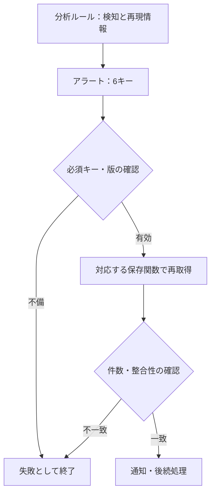

# Sentinel：Custom Detailsから全量を渡さず、Logic Appで取り直す

公開日: 2026-10-31 · 種別: 検証資料の記録 / 後続の作業記録 / 合成例

## 問題と方針

検知対象のResourceIdをCustom Detailsへ大量に格納すると、サイズ制約で必要な情報が欠落する。ここで再現したのは**Custom Detailsの約2KBというサイズ制約**に関する問題であり、「Logic Appの配列が2,048件を超える」という説明とは区別する。

Custom Detailsには再現の手がかりだけを載せ、Logic AppからLog Analyticsを再クエリしてResourceIdの全量を取得する方式を検証した。

## 保存された検証資料の結果

| 確認 | 記録された結果 |
|---|---|
| ResourceId 40件を直接格納 | 約4,601文字の配列でResourceIdキーの欠落を再現 |
| 再現用6キーへ変更 | 資料上の計測で約370B相当、6キーが保持された |
| Aの手動再クエリ | 40行、元の集合と過不足なし |
| Bの手動再クエリ | 5行、Aと混在しなかった |
| Logic AppによるAの再クエリ | 40件取得、ResourceCount照合成立。資料上の所要時間は約0.7秒 |

合成データの方式検証であり、本番ルール全体の成功率を示すものではない。文字数とバイト数も同一ではなく、上の数値を全データに共通する上限測定とは扱わない。

初期の資料では、通知前停止、5件側のLogic App確認、バージョン値の確認、遅延取り込み制御が未完了だった。後続の作業記録には、Watchlist登録を修正し、5件・40件の双方で通知処理まで進んだ記録がある。後者の実行履歴原本はこの版に添付していない。

## 固定した6キー

| キー | 役割 |
|---|---|
| `DetectionKey` | 検知グループの識別 |
| `DetectionWindowStart` | 対象期間の開始 |
| `DetectionWindowEnd` | 対象期間の終了 |
| `DetectionCutoff` | 取り込み時刻等を制限する基準 |
| `ReplayQueryVersion` | 再クエリ実装の版 |
| `ResourceCount` | 期待件数 |



図は目指す処理全体。過去の各版で全検査が実装済みだったという意味ではない。

## 分析ルールと保存関数は別

分析ルールは検知してアラートを生成する。保存関数は呼び出しに応じてクエリ結果を返す。複数ルールで参照テーブル・列が違うなら、再現関数もルール単位で分け、共通の条件だけを共通関数へ切り出す。

返り値は原則`ResourceId`の1列とし、重複除去・ソートを揃える。`ReplayQueryVersion`から許可した関数へ対応づける。古いアラートの条件が変わらないよう旧版を残し、任意の関数名やKQLをアラートから直接組み立てない。

## 件数が同じでも集合が違うことがある

40件という件数が一致しても、別の40件に入れ替わっていれば同じ結果ではない。方式検証では期待集合も比較する。厳密な履歴再現が必要なら、検知時の集合やダイジェストを別途保存する設計が必要になる。

取り込み遅延、保持期間、データ削除、Watchlist・パーサー変更、集約上限でも結果は変わる。絶対時刻の固定だけで完全な再現性が保証されるわけではない。

## 追試用の合成例

[KQL例](../examples/replay-function.kql)はA=40件・B=5件を返す形を示す。実ログを読む関数や本番分析ルールではない。

実行:

```bash
python3 examples/verify_replay.py examples/replay-fixture.json
```

確認:

```bash
python3 -m json.tool examples/replay-fixture.json > /dev/null
```

照合スクリプトは重複、件数、集合一致、A/Bの混在を検査する。Azureへの接続は行わない。
